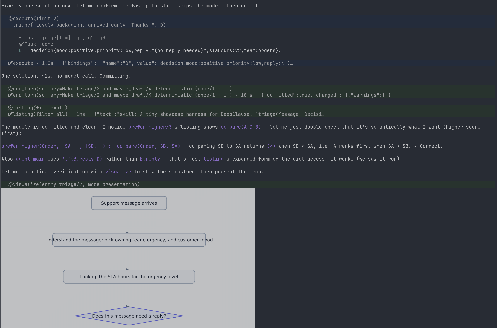

# DeepClause SDK

**Effortlessly build efficient model-, task-, or domain-specific harnesses.**

Follow us on [X (@hilbertshelper)](https://x.com/hilbertshelper) · Blog: [deepclause.substack.com](https://deepclause.substack.com)

DeepClause is a **Prolog-based runtime for self-modifying agent harnesses**. A
harness created with DeepClause is a self contained library in the form of a **DML** module. DML (DeepClause Meta Language) is a Prolog DSL with added functionality for LLM model calls, semantic
judgments (Jev-type models), and constraints. An LLM agent embedded in the runtime reads, extends, and tests code in a live module a turn by
turn. You drive it from an interactive **REPL**. Using the REPL once can successively build a custom harness that is optimized for a specific use case.

DML runs on **SWI-Prolog compiled to WebAssembly** — the whole language runtime
is in-process and portable, with no native Prolog to install.

Most agent stacks contain a lot of separate moving parts: tools in one place,
prompts in another, memory in a third, and the workflow as a graph or a chain
somewhere else. DML folds them into one idea — a **predicate**. A skill is a
clause, a tool is a clause, memory and state are clauses, control flow and
retries are clause order and backtracking, and a workflow is simply predicates
calling predicates. Because it is one language in one self-contained file, the
parts can read, reuse, and extend one another, and a whole harness can be
inspected, versioned, and moved as a unit.

That shape pays off most when a capability is *specific*. Because a harness is a
single module you can edit, diff, and version — and because the REPL lets an
authoring agent grow it by talking — it is unusually cheap to build one tuned to
a particular **model** (its prompt style, context budget, reasoning level), a
particular **task**, or a particular **domain**. The same file can also route
individual calls across several models with `with_model/2`: a cheap model for
classification, a strong one for the hard step, all decided in plain Prolog.



## Dependencies and acknowledgements

DeepClause stands on other people's work, and is grateful for it:

- **[Pi](https://pi.dev)** (`@earendil-works/pi-coding-agent` and
  `@earendil-works/pi-ai`) — the `pi` backend reuses Pi's model catalog,
  credential store, streaming, cancellation, and usage accounting, and the
  interactive REPL TUI is built on Pi's terminal UI library
  (`@earendil-works/pi-tui`). Thanks to the **Pi developers** for building and
  sharing it.
- **[SWI-Prolog](https://www.swi-prolog.org/)** — the Prolog engine that DML
  runs on, compiled to WebAssembly so the whole runtime is in-process and
  portable. SWI-Prolog is created and maintained by **Jan Wielemaker** and the
  SWI-Prolog community.
- **[Markus Triska](https://www.metalevel.at/)** — his work on
  meta-interpreters, constraint logic programming, and the
  `library(clpfd)`/`library(clpq)` libraries underpins DML's executable
  meta-interpreter and constraint layer.

DML, the REPL, and the SDK are original work; these projects are used as
dependencies and as conceptual foundations.

## Why would I use this?

- **Reproducibility.** Control flow, retries, and validation are Prolog clauses
  you can read and re-run, so a DML harness tends to produce the same result shape
  across sessions and machines. The model is consulted only at the points you
  choose, and its outputs are typed where that helps.
- **Auditability.** Each turn is a transaction: the module is snapshotted, the
  change is committed replace-by-predicate, and the session, event trace, and
  harness versions are recorded and remain queryable. It is possible to see what
  changed, when, and in response to what.
- **Regulated and high-stakes settings.** Where a workflow has to be reviewed,
  versioned, and reproduced — and where it helps to keep deterministic logic
  separate from model judgment — a small, inspectable harness is easier to
  scrutinise than a prompt. The transaction record and `rollback.` are meant to
  support that kind of review, not replace it.
- **Research in neurosymbolic AI.** DML offers a concrete substrate for
  combining symbolic reasoning (Prolog, CLP, backtracking) with LLM calls and
  semantic judgments in one program, and for studying how such a system behaves
  as an agent edits it over time (transactions, history, rollback).

It is likely not worth it when a single prompt or a short script is enough, or
when there is no structure you would want to reuse, review, or reproduce.

## The REPL: a living, self-modifying harness

The REPL keeps a persistent DML module ("the harness"). You talk to it in two ways:

| Input | Mode |
|---|---|
| `<plain English>` (default) | **author** — the agent writes, tests, and commits DML |
| `/goal <dml>` | **run** — query the current harness |

```text
dml> add a research(Question, Answer) skill that answers with task/2 and cites sources
dml> run research on "why is the sky blue?"
A = "Rayleigh scattering scatters short wavelengths more strongly..."

dml> /goal research("why is the sky blue?", A).   % the same skill, run directly
```

The default mode is the interesting one: describe what you want and the
authoring agent edits the module for you through tools, testing as it goes. Ask
for anything — add a skill, add a tool, change existing logic, run or test code
in the living module, or just ask a question about the harness.

### A worked session

A full pass: create a skill, watch the transaction, run it, export it, and load
it again as a new harness.

**1. Create (one transaction)**

```text
dml> add a research(Question, Answer) skill that answers with task/2

  ⚙ begin_turn
  ✔ begin_turn · 2ms
  ⚙ assert_many(clauses=module_doc("…"), research(Question, Answer) :- task(…), doc(research/2, …))
  ✔ assert_many · 11ms
  ⚙ execute
    research("Why is the sky blue?", A).
      ▸ Task  Answer this research question: Why is the sky blue?
      ✔ Task  done
      A = "Rayleigh scattering…"
  ✔ execute · 3.7s
  ⚙ end_turn(summary=Add research/2)
  ✔ end_turn · 4ms — {"committed":true,"changed":["+research/2","+module_doc/1","+doc/2"]}

Added research/2 — a one-call task/2 research skill.
```

The agent opened a transaction (`begin_turn`), wrote the predicates
(`assert_many`), tested them with `execute`, and committed with `end_turn` — which
printed the predicates it changed and recorded a version. Had the turn failed,
the host would have rolled the module back to exactly its prior state.

**2. Inspect, run, undo**

```text
dml> /listing
skill: Research a question and return a written answer.

doc/2
doc(research/2,"Answer a question in one model call. research(+Question, -Answer). …").

module_doc/1
module_doc("Research a question and return a written answer. …").

research/2
research(A,B) :-
    task("Answer this question: {A}",B).

dml> /goal research("Why is the sky blue?", A).
A = "Rayleigh scattering…"

dml> /rollback
rolled back harness: version 1 → 0

dml> /goal research("Why is the sky blue?", A).
false.                       % the skill is gone
```

`end_turn` is the only commit point, and `/rollback` moves the harness back one
committed version (here, to the baseline) — so nothing is committed silently.

**3. Export**

```text
dml> /export research.dml
exported 3 clauses, 0 tools, 0 scripts → research.dml
```

`research.dml` is a plain DML file: commit it, diff it, mail it. Use a `.zip`
target to bundle linked `script_file/2` scripts.

**4. Load it elsewhere (a harness from somewhere else)**

```bash
deepclause repl -l research.dml
```

Loading a file targets the harness named after it (`research`), creating it if
needed. The file becomes that harness's **baseline**, so it works with no prior
history: `/rollback` floors at the loaded file, never at empty.

**5. Several harnesses in one project**

```bash
deepclause repl                    # harness `main`
deepclause repl --harness support  # harness `support`
deepclause repl -l research.dml    # harness `research`
```

Each harness has its own content and version history under
`.deepclause/repl/harnesses/<name>/`. A fresh session loads its harness's current
content (the agent continues what is there instead of re-creating it), and
`/rollback` never crosses harnesses.

### Example: build a coding agent

You can ask for a whole **capability**, not just a one-off answer:

```text
dml> build me a coding agent harness for this repo

  ⚙ listing
  ✔ listing · 1ms
  ⚙ begin_turn
  ✔ begin_turn · 2ms
  ⚙ define(head=run_shell(Command, Output), clauses=run_shell(Command, Output) :- exec(bash(…), Result), …)
  ✔ define · 31ms
  ⚙ define(head=fs_read(Path, Text), clauses=fs_read(Path, Text) :- read_file(Path, Text).)
  ✔ define · 6ms
  ⚙ define(head=fs_write(Path, Content), clauses=fs_write(Path, Content) :- write_file(Path, Content).)
  ✔ define · 5ms
  ⚙ define(head=fs_grep(Pattern, Path, Matches), clauses=fs_grep(Pattern, Path, Matches) :- …)
  ✔ define · 7ms
  ⚙ assert_many(clauses=tool(run_shell(…)) :- run_shell(…). tool(fs_read(…)) :- …. …)
  ✔ assert_many · 4ms
  ⚙ define(head=explain(Question, Answer), clauses=explain(Question, Answer) :- system(…), with_tools(…).)
  ✔ define · 8ms
  ⚙ define(head=patch(File, Issue, Summary), clauses=patch(File, Issue, Summary) :- system(…), with_tools(…).)
  ✔ define · 9ms
  ⚙ execute
    fs_read("package.json", T), run_shell("npm test", R).
  ✔ execute · 1.4s
  ⚙ end_turn(summary=Add coding-agent skills: run_shell/fs_read/fs_write/fs_grep + explain/patch)
  ✔ end_turn · 12ms — {"committed":true,"changed":["+run_shell/2","+fs_read/2","+fs_write/2","+fs_grep/3","+explain/2","+patch/3"]}

A coding-agent harness is ready: a small shell/file toolset exposed to `task/N`, plus
`explain/2` and `patch/3` skills that scope those tools per task.
```

The harness it built (trimmed):

```prolog
module_doc("Coding agent: read, search, and edit a repository and run its tests.").

run_shell(Command, Output) :-
    exec(bash(command: Command), Result),
    ( get_dict(stdout, Result, Out) -> Output = Out ; Output = "" ).

fs_read(Path, Text) :- read_file(Path, Text).
fs_write(Path, Content) :- write_file(Path, Content).

fs_grep(Pattern, Path, Matches) :-
    format(atom(Cmd), "grep -rn -- ~w ~w", [Pattern, Path]),
    exec(bash(command: Cmd), Result),
    ( get_dict(stdout, Result, Out) -> Matches = Out ; Matches = "" ).

% `tool/2` only exposes the predicates above to the nested agent in task/N.
tool(run_shell(Command, Output), "Run a shell command; returns stdout.") :- run_shell(Command, Output).
tool(fs_read(Path, Text), "Read a workspace file.") :- fs_read(Path, Text).
tool(fs_write(Path, Content), "Write a workspace file.") :- fs_write(Path, Content).
tool(fs_grep(Pattern, Path, Matches), "Search a path; returns matching lines.") :- fs_grep(Pattern, Path, Matches).

doc(explain/2, "Explain code relevant to a question. explain(+Question, -Answer).").
explain(Question, Answer) :-
    system("You are a coding assistant working in a repository. Cite file paths and line numbers."),
    with_tools([run_shell, fs_read, fs_grep],
        task("Answer this question about the repository: {Question}", Answer)).

doc(patch/3, "Apply a minimal fix and run the tests. patch(+File, +Issue, -Summary).").
patch(File, Issue, Summary) :-
    system("Make the smallest change that fixes the issue. Run the project's tests and report the result."),
    with_tools([run_shell, fs_read, fs_write, fs_grep],
        task("Fix this issue in {File}: {Issue}. Then run the tests and report what changed.", Summary)).
```

Use it:

```text
dml> /goal explain("where are the CLI entry points?", A).
A = "…"

dml> /goal patch("src/cli.ts", "the --help flag is missing", S).
S = "…"

dml> /export coding_agent.dml
```

```bash
deepclause repl -l coding_agent.dml                             # harness `coding_agent`
deepclause run coding_agent.dml --goal 'explain("…", A)'       # one-shot
```

Notes:

- `tool/2` is only an annotation; the *capabilities* are the predicates above, so
they are reachable from `execute` / `/goal` **and** from `task/N`.
- `with_tools/2` scopes which tools a `task/N` turn may call — `explain` cannot
edit files, `patch` can.
- Because a `task/N` turn can call these tools (and itself), the module is an
RLM-style harness, not a fixed script.

### Model switching

A harness can choose the model for individual calls with `with_model/2`, so you
can route cheap work to a small model and hard work to a strong one — or tune a
whole harness to one model:

```prolog
% a cheap model for classification
triage(Message, Team) :-
    with_model("openai:gpt-4o-mini",
        prompt("Classify as billing/orders/account: {Message}", Team)).

% a strong model at high reasoning, only for the hard step
review(Diff, Notes) :-
    with_model("anthropic:claude-sonnet-4#high",
        task("Review this diff and list defects:\n{Diff}", Notes)).

% full control via a dict
with_model(model{provider: "google", id: "gemini-2.5-pro",
                 temperature: 0.2, maxTokens: 8192}, Goal).
```

`with_model` scopes the `task/N`, `prompt/N` and `sample_token/N` calls inside
`Goal` (judgments keep their own backend); the innermost scope wins, and it
composes with `with_reasoning/2`. The models available to a session are the
**credentialed** ones from pi's catalog, each shown to the authoring agent with
its price (USD per 1M tokens, in/out) so it can pick the cheapest model that
fits — call the `models` tool for the live list. An unknown or unsigned-in model
fails with a clear error.

### Sessions

The REPL also records sessions, turns, and harness versions under
`.deepclause/repl/`, so you can pick a conversation back up later. Its harness,
conversation memory, and turn count are restored:

```bash
deepclause repl --session last          # resume the most recent session
deepclause repl --session repl_m9x1_1   # …or one by id
```

### Why Prolog/DML for a self-modifying harness

An RLM-style harness works best when the harness *is* the program the model
edits. DML makes that literal:

- **The harness is data = code.** Skills are predicates, data is facts
  (`city(ch, "Zürich").`). The model reads it (`listing`), queries it
  (`/goal`), extends it, and reuses it — no separate plugin format and no
  recompile step.
- **One language for logic and language.** Recursion, backtracking, and CLP
  constraints sit next to LLM calls (`task/N`) and typed semantic judgments
  (`choose`, `verify`, `rate`, `probability`) in the same clause.
- **Composable skills.** A `task/N` call runs a bounded agentic turn that may
  itself call other skills, so the library grows by composition and reuse.
- **Small and inspectable.** Everything a harness can do is visible in the
  module and the host tool catalog (by default `bash`, plus the human-in-the-loop
  `ask_user` / `input/2`).

### Transactions

A prompt turn is an **edit transaction**:

1. the living module is snapshotted;
2. the authoring agent edits predicates with tools (`define`/`assert`/`assert_many`/
   `retract`/`delete`) and tests them with `execute`;
3. `end_turn` validates and commits the change, recording a version;
4. `rollback` — or a failed turn — restores the harness unchanged.

For anything larger than a couple of predicates the agent is instructed to commit
working pieces as it goes (`execute` → `end_turn` → `begin_turn`), so a late
failure does not lose earlier progress.

### Auditability

Every session, turn, event trace, and harness version is written under
`.deepclause/repl/` — per harness under `harnesses/<name>/` (`harness.dml`,
`baseline.dml`, `HEAD.json`, `changes.jsonl`, `versions/`) — and exposed to DML
as queryable `harness_*` facts (`harness_session/5`, `harness_turn/5`,
`harness_change/5`, `harness_changed/4`, `harness_head/4`, `harness_trace/3`).
`rollback.` restores the previous version, step by step, and a harness can query
its own past:

```prolog
recent_changes(N, Changes) :-
    findall(Version-Timestamp, harness_change(Version, Timestamp, commit, _, _), All),
    last_n(All, N, Changes).
```

See [`docs/REPL.md`](docs/REPL.md) and
[`docs/DML_REPL_SESSION_HISTORY.md`](docs/DML_REPL_SESSION_HISTORY.md).

### Commands

`/goal <dml>`, `/listing [filter]`, `/viz [entry] [--spec]`, `/show <path>`,
`/gen <prompt>`, `/spawn <goal>` (`/serve`), `/ps [--watch|--logs|--code]`,
`/send <name> <term>` (`/cast`), `/call <name> <term>`, `/stop <name>`,
`/model [id]`, `/reasoning [level]`, `/show-reasoning [mode]`,
`/harness [width]`, `/login`, `/help`, `/reset`, `/rollback`, `/compact [notes]`,
`/export [file]`, `/freeze`/`/unfreeze`, `/params`, `/trace`/`/notrace`,
`/halt` (aliases `/exit`, `/quit`). The legacy `goal:`/`listing.` dotted forms
still work.

## Subagents and concurrency

The REPL can run **subagents**: session-scoped DML processes that keep running
after the turn that started them, talk to each other by messages, and run in
parallel. Start one with `/spawn`, watch them with `/ps --watch --logs`, and
message them with `/send` / `/call`:

```text
dml> /spawn debate("Nuclear power should expand", 2)
spawned proc(main, sess_abc, p1)
dml> /ps --watch --logs
──────────────────────────────────────────────
⚙ services — 2 processes · 2 active · debater running · debater running
──────────────────────────────────────────────
  debater       PRO opening: the evidence supports setting a price…
  debater       CON (round 2): a price is regressive without a rebate…
  debater   ✓   set_result
  debater   ›   finished
```

The authoring agent uses the same machinery through its `ps` / `send` / `stop` /
`swarm` / `wait` tools, and drives `spawn` and request/reply through `execute`
with the DML built-ins (`spawn`, `send`/`receive`, `serve`/`service_call`,
`swarm`/`pmap`). A
subagent runs against a **private snapshot** of the module with **value
semantics** — a result comes back by message, never by a shared variable — which
is what makes it safe to run many at once.

Execution has two modes: `--execution worker` (the default; a worker thread with
its own WASM — true parallelism and hard cancellation) and `--execution inline`
(cooperative, in-process). The same DML runs unchanged.

See [`docs/SUBAGENTS.md`](docs/SUBAGENTS.md) for the model, the surface, the
Erlang/BEAM inspiration, and the L1/L2 seam.

## Install

```bash
npm install deepclause-sdk
```

## Quick start

```bash
deepclause init                 # write .deepclause/config.json
deepclause login                # sign in to provider, then pick a model
deepclause repl                 # interactive
deepclause repl --session last  # resume the most recent session
deepclause run skill.dml "arg"  # one-shot
```

### Backends

`pi` is the default: it reuses pi's model catalog and credential store. `env`
uses the SDK's own provider/API keys.

```bash
deepclause login [--provider <id>] [--api-key <key>|--oauth] [--model provider/model] [--thinking <level>]
deepclause logout [provider]
deepclause set-backend status
deepclause set-backend env       # switch to provider API keys
```

For reasoning-capable models, `deepclause login`/`set-backend`/`set-model` prompt
for a thinking level (`off|minimal|low|medium|high|xhigh|max`); pass `--thinking`
to skip the picker. It is stored as `backend.thinkingLevel` and forwarded to pi
only for models that support it.

Credentials live in pi's agent dir (`~/.pi/agent`) unless `backend.agentDir`
overrides it. Existing pi installations stay untouched.

### Local models (Ollama, llama.cpp, vLLM)

The default `pi` backend reads pi's `models.json`, which can declare **custom
OpenAI-compatible providers**, so a local server needs no SDK changes:

```jsonc
// ~/.pi/agent/models.json
{
  "providers": {
    "loc": {
      "name": "Local server",
      "baseUrl": "http://localhost:11434/v1",   // Ollama; llama.cpp: http://127.0.0.1:8080/v1
      "apiKey": "ollama",                        // any string; satisfies the auth check
      "api": "openai-completions",               // not openai-responses
      "models": [{
        "id": "llama3.1",
        "contextWindow": 131072,
        "maxTokens": 8192,
        "reasoning": false,
        "input": ["text"],
        "cost": { "input": 0, "output": 0, "cacheRead": 0, "cacheWrite": 0 }
      }]
    }
  }
}
```

```bash
deepclause set-backend pi --list   # lists "loc (Local server) — configured [api-key]"
                                   # and the model "loc/lecho"
deepclause repl --model loc:llama3.1
```

`run` has no `--model` flag; set `backend.model` instead. DML can route a single
step there as well — `with_model("loc:llama3.1", Goal)`.

Point at a non-default file with `backend.modelsPath` in
`.deepclause/config.json` (or `PI_CODING_AGENT_DIR` to move pi's whole agent
dir), which keeps a project's catalog in the repository rather than the home
directory:

```json
{ "backend": { "kind": "pi", "model": "loc:llama3.1", "modelsPath": "./agent/models.json" } }
```

- **`api` picks the wire protocol.** `openai-completions` is what Ollama,
  llama.cpp, vLLM and SGLang serve; `openai-responses` is the newer OpenAI API.
  Per-provider `compat` flags cover servers that differ
  (`maxTokensField`, `supportsUsageInStreaming`, `requiresToolResultName`, …),
  and a model's `samplingParams` forwards `top_p`/`top_k`/`repetition_penalty`.
- **Tool calling is required for `task/N`**, which ends by calling
  `set_result`/`finish`; a text-only model exhausts the turn instead. `chat/1`
  needs no tools, so a small local model is usable there, or pick a model whose
  chat template supports tools.
- **`list-models` prints the bundled model database** and will not show custom
  entries; `set-backend pi --list` prints pi's catalog, which does.
- The `env` backend can also point at a local server
  (`providers.openai.baseUrl` + `apiKey`), but it always speaks chat completions
  and **`repl` ignores `providers.*.baseUrl`** today — prefer the `pi` backend.

## run

`run` uses the **same engine as the REPL**: it opens a module, loads the
DML file (`.dml` or a `.zip` bundle), runs one entry, and renders events through
the REPL renderer. The entry is `agent_main/N` (chosen by the number of
positional arguments) or an explicit `--goal`.

```bash
deepclause run <file.dml> [args...]                  # call agent_main/N
deepclause run <file.dml> --goal '<dml>'             # explicit entry goal
deepclause run <file.dml> --dry-run                  # print the resolved entry
deepclause run <file.dml> --trace t.json --usage u.json
deepclause run <file.dml> --no-stream --no-events    # only outputs/answers
```

## Runtime and sandboxing

**Engine.** DML is executed by **SWI-Prolog compiled to WebAssembly**
(`vendor/swipl-wasm`, loaded through `src/prolog/`). It runs in-process — no
native Prolog install, no external server — with the standard SWI libraries
available (constraint solving via `clpfd`, `clpq`, `clpr`; plus regex, dicts,
and DCGs). Validation runs on the same engine.

**Workspace confinement.** DML file predicates and `bash` all run against the
active **workspace** (`.` or `--workspace <path>`) using workspace-relative
paths; harness paths cannot escape it.

**Shell execution.** `bash` is the only capability tool, with two backends:

| Backend | When | Notes |
|---|---|---|
| host shell | default | isolated by a wrapper: `clean-room`, `bwrap` (bubblewrap), or `sandbox-exec` (macOS); `auto` picks the best available |
| AgentVM | `--sandbox` | WASM micro-VM; network disabled by default |

Network access is **off by default** (`agentvm.network: false`), and `bwrap`
with `shell.strictIsolation: true` also disables it. `--no-tools` registers no
capability tool at all; `ask_user` / `input/2` remain the human-in-the-loop
channel.

```bash
deepclause repl --sandbox      # run bash inside the AgentVM micro-VM
deepclause repl --no-tools     # no capability host tools
```

```json
{
  "agentvm": { "network": false },
  "shell": { "wrapper": "auto", "strictIsolation": false }
}
```

## visualize

Turn a harness into a diagram: `visualize` reads the harness `listing`
(source + `doc/2` annotations) and asks the active model for a Mermaid chart of
one entry, then renders it.

```bash
deepclause visualize skill.dml -g router/2 --presentation -o router.png
deepclause visualize skill.dml -g router/2 --spec -o router.spec.svg
deepclause visualize skill.dml -g router/2 --ascii
```

`-g/--goal` names the entry predicate to document. `--presentation` (default) is
an audience-facing overview (inputs, steps, answer); `--spec` shows engineering
detail (decisions, `task`/`exec` calls, branches, fallbacks). A `.mmd` output
writes the Mermaid source; `.svg`/`.png` render it **without a browser** (SVG is
generated directly, PNG via the bundled `@resvg/resvg-js` rasterizer), and the
`.mmd` is always written beside the image. `--ascii` prints a terminal-friendly
Unicode tree instead of a file.

In the REPL, `/viz [entry] [--spec]` draws a skill inline: on Kitty/Ghostty/
WezTerm/iTerm2 it emits an inline image (through pi-tui's terminal-image encoder);
on other terminals it falls back to the ASCII tree. Force a renderer with
`/viz --graphics=kitty|iterm2|ascii|off`. The authoring agent's `visualize` tool
uses the same path, so *"visualize this harness"* paints the image too (and
falls back to the ASCII tree on terminals without image support).

## Media (images)

Images are workspace files referenced by a `media(Path, Mime)` term; the bytes
never enter Prolog or conversation memory. Read a reference and attach it, and the
next `task/N` sends it to a vision-capable model:

```prolog
agent_main :-
    read_media("photos/fox.png", Image),
    attach_media(Image),
    task("Describe the image in one sentence.", Description),
    answer(Description).
```

Only PNG/JPEG/GIF/WebP/SVG are accepted, and judgments stay text-only.

Images can also be **displayed** and **generated**:

```prolog
output(media("charts/plot.png")).        % show an image inline (kitty/iTerm2)
task("a red fox in snow", media(Img)),    % generate → Img = "…/image-….png"
output(media(Img)).                        % …and show it
```

`output(media{svg: Svg})` shows inline SVG; `save_image(Media, "out.svg")`
persists a reference. On other terminals the path is printed (and opened with
`xdg-open`/`open`), and `--json` emits a `media` event with base64 PNG data. In
the REPL: `/show <path>` and `/gen <prompt>`. See [`docs/DML_MEDIA.md`](docs/DML_MEDIA.md).

## TypeScript SDK

```ts
import { createDeepClause } from 'deepclause-sdk';

const dc = await createDeepClause({ model: 'gpt-4o', provider: 'openai' });
for await (const event of dc.runDML(dmlSource, { args: ['topic'] })) {
  if (event.type === 'answer') console.log(event.answer ?? event.content);
}
await dc.dispose();
```

To reuse pi's model and credentials from a host, pass an injected `LLMBackend`
(`createPiBackend`) and judgment backends (`createLLMJudgeBackend`,
`createJevJudgeBackend`).

The REPL is embeddable too:

```ts
import { createHarnessRepl } from 'deepclause-sdk';

const repl = await createHarnessRepl({ model: 'gpt-4o', provider: 'openai' });
for await (const event of repl.query('fact(5, F)')) {
  if (event.type === 'solution') console.log(event.solution?.bindings);
}
await repl.dispose();
```

## Validation

```ts
import { validateWithProlog } from 'deepclause-sdk/validate';

const { valid, errors, warnings } = await validateWithProlog(dmlSource);
```

## Configuration

`.deepclause/config.json` (created by `init`):

```json
{
  "backend": { "kind": "pi", "model": "anthropic/claude-sonnet-4" },
  "temperatures": { "run": 0.7 },
  "providers": { "openai": { "apiKey": "..." } },
  "agentvm": { "network": false },
  "shell": { "wrapper": "auto", "strictIsolation": false, "timeoutMs": 0, "idleTimeoutMs": 180000 },
  "repl": {
    "tui": "auto",
    "harness": "main",
    "showReasoning": "summary",
    "maxModelCalls": 100,
    "compaction": { "enabled": true, "auto": true },
    "media": { "dir": ".deepclause/media", "open": true, "inlineJson": true, "imageModel": "openai:gpt-image-1" },
    "history": { "enabled": true, "dir": ".deepclause/repl", "trace": "summary" }
  },
  "judgment": { "default": "llm", "jev": { "enabled": false } }
}
```

## Repository layout

```text
src/
├── repl/         # living-module REPL (session, agent, render, history, media,
│                 #   processes, process-executor, worker-host, models)
├── cli/          # init, run, repl, login, set-backend, visualize
├── visualize/    # diagrams: Mermaid → Unicode tree / SVG / PNG + terminal graphics
├── system/       # shell/AgentVM, config, model database + catalog, bundled docs
├── judge/        # semantic judgment backends (llm, jev, mock)
├── prolog/       # SWI-Prolog-WASM loader/bridge
├── prolog-src/   # deepclause_mi.pl, deepclause_analysis.pl, …
├── agent.ts      # task/agent loop
├── runner.ts     # DML execution
├── sdk.ts        # createDeepClause
└── validate.ts   # DML validation/linting

vendor/
└── swipl-wasm/   # SWI-Prolog compiled to WebAssembly (the DML engine)
```

Bundled prompt assets: `AGENT_PROMPT.md` (the authoring agent's contract),
`DML_REFERENCE.md` (language), `DML_AUTHORING.md` (guide),
`HARNESS_EXAMPLES.md` (idiomatic shapes), `HARNESS_PATTERNS.md` (harness shapes
by use case), `PROLOG_SNIPPETS.md` (tested building blocks).

## Development

```bash
npm run build     # tsc + copy prolog + assets
npm test          # vitest
npm run repl      # deepclause repl via tsx
```

**`npm run build` is required for the default process backend.** L2 (worker)
processes run `dist/repl/process-worker.js`, so editing `src` without rebuilding
runs old worker code against a new main — the symptom used to be child sessions
that silently had no harness. `WORKER_PROTOCOL_VERSION` now fails that loudly
(`stale L2 process worker: … run 'npm run build'`). The tests that need it
(`repl-process-worker-child`) skip themselves when `dist` is absent.

See [`docs/`](docs/): [`SUBAGENTS.md`](docs/SUBAGENTS.md) (subagents and
concurrency), [`STATUS.md`](docs/STATUS.md) (current state),
[`REPL.md`](docs/REPL.md),
[`DML_REPL_PROPOSAL.md`](docs/DML_REPL_PROPOSAL.md),
[`DML_REPL_SESSION_HISTORY.md`](docs/DML_REPL_SESSION_HISTORY.md),
[`DML_MEDIA.md`](docs/DML_MEDIA.md),
[`DML_MODEL_SWITCHING.md`](docs/DML_MODEL_SWITCHING.md),
[`DML_REPL_WORKER_EXECUTION.md`](docs/DML_REPL_WORKER_EXECUTION.md) (plan),
[`DML_FORMS.md`](docs/DML_FORMS.md) (structured human input),
[`JUDGMENT_BACKENDS.md`](docs/JUDGMENT_BACKENDS.md).

## License

MIT
